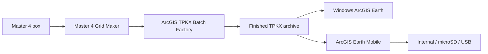

# ArcGIS Earth Offline Maps & Field Tracking

> 🤖 **Using AI assistance?** Have the agent read the [CLAUDE.md](https://github.com/Jim-dc95811/ArcGIS-Earth-Unlocked/blob/main/CLAUDE.md) file first.

## 🛰️ NEW — P25 GPS Tracker: your radios' GPS, live on your offline map

**The original Holy Grail, achieved.** Pull GPS straight out of your agency's BK P25 radios and plot each unit — by name — on your own offline ArcGIS Earth imagery. Free and open: no cloud, no vendor subscription, no BK dongle. The tracker only ever **reads** the radio; it never reprograms anything.


### **⬇️ [DOWNLOAD P25 GPS TRACKER v0.4](downloads/P25_GPS_Tracker_v0.4.zip)**
**📖 [Operator guide](docs/P25_GPS_TRACKER.md)**
**📦 [Download the Whole ArcGIS Earth Unlocked Series of Tools](https://github.com/Jim-dc95811/ArcGIS-Earth-Unlocked/raw/main/downloads/ArcGIS_Earth_Unlocked_All_Tools.zip)**

- **One marker per unit, by name.** The sending radio's P25 unit ID is the key; name it once (`9076801 → Jax 24`) and it sticks across sessions. An un-named unit still shows its raw ID, so no dot is ever a mystery.
- **Live-tested on real radios.** Two portables reporting through a base M150 relay plotted as two separate, named, correctly-separated units on offline imagery — pinpoint accurate.
- **Built for the field.** Live / Stale / Expired aging (amber marker + age label), a pick-your-own retirement time (30 minutes to Never), keepalive + auto-reconnect, coordinate sanity, and a daily CSV track log.
- **How it works:** the base radio, connected as a USB Ethernet/RNDIS gadget, relays each received fix as standard NMEA — a `$GNGGA` position plus a proprietary `$PP25` unit-ID sentence — which the tracker reads and draws through ArcGIS Earth's local Automation API. Nothing is decrypted; it is standard interoperability with your own equipment on your own licensed channels.

> The standalone tracker above is the proven, everyday tool most operators will use. If you also run a Raveon fleet, the same P25 feed folds into the **PRAVE / ME Tracker** as a third source — see the *trifecta* build under that tool below.

---

## Get everything you need

**1. ⬇️ [ArcGIS Earth](https://www.esri.com/en-us/arcgis/products/arcgis-earth/downloads)** - free 3D globe from Esri (Windows desktop version); it shows the maps and the tracker.

**2. ⬇️ [ArcGIS Pro 3.7](https://esri.com/en-us/arcgis/products/arcgis-pro/trial)** - Esri's licensed desktop GIS (21-day free trial). Batch Factory only.

**3. ⬇️ [.NET 10 SDK](https://dotnet.microsoft.com/en-us/download/dotnet/10.0)** - free from Microsoft; the Batch Factory installer uses it. Batch Factory only.

**4. ⬇️ [Python 3](https://www.python.org/downloads/windows/)** - free; install with the default options. The tracker and tester need one add-on, pyserial, which their launchers **install automatically** the first time (needs internet once). Tracker and tester only.

> **First time? Three quick tips**
> 1. **Extract the zip first:** right-click the downloaded zip > **Extract All**, then open the new folder. Double-clicking files while they are still inside the zip does not work.
> 2. **Windows security warning:** Windows may warn about any program downloaded from the internet. Click **More info > Run anyway** (blue "Windows protected your PC" screen) or **Run**. To avoid the warning, right-click the zip > **Properties** > tick **Unblock** > **OK** before extracting.
> 3. **Installing Python:** if the installer shows **"Add python.exe to PATH"**, tick it.

> **2.0 (8 Nov 2026):** the whole ArcGIS Earth Unlocked family moved to 2.0 as one reference point ([2.0 Reference](https://github.com/Jim-dc95811/ArcGIS-Earth-Unlocked/blob/main/REFERENCE_2.0.md)). Batch Factory 2.0 and PRAVE / ME Tracker 2.0 are the same programs with the version text changed; the download names stay the same so old links keep working. The PRAVE / RMC tester stays *Gold*. Earlier zips are kept in [`archive/`](archive/).

### **⬇️ [5. DOWNLOAD ARCGIS TPKX BATCH FACTORY v2.0](downloads/TPKX_Batch_Factory_v1.zip)**
**📖 [User manual](docs/TPKX_BATCH_FACTORY.md)** ([PDF](docs/TPKX_Batch_Factory_User_Guide.pdf))
**🗂️ [What's in the zip - every file explained](images/tpkx_batch_factory_whats_in_the_zip_full.png)**
**📦 [Download the Whole ArcGIS Earth Unlocked Series of Tools - all 10 in one zip](https://github.com/Jim-dc95811/ArcGIS-Earth-Unlocked/raw/main/downloads/ArcGIS_Earth_Unlocked_All_Tools.zip)**

ArcGIS Pro add-in that turns controlled extents into Satellite, Road Overlay, or Both TPKX packages at Z16-Z20. The extents come from the [Master 4 Grid Maker](https://github.com/Jim-dc95811/QGIS-Mbtile-to-ArcGIS-Earth-TPKX/blob/main/MASTER4_GRID_MAKER.md).


*The Batch Factory inside ArcGIS Pro: pick the map product, maximum zoom and destination, paste up to 10 extents, then BUILD BATCH.*

### **⬇️ [6. DOWNLOAD PRAVE / ME TRACKER v2.1](downloads/PRAVE_ME_Tracker_v1.zip)**
**📖 [User manual](docs/PRAVE_ME_TRACKER.md)**
**🗂️ [What's in the zip - every file explained](images/prave_me_tracker_whats_in_the_zip_full.png)**
**📦 [Download the Whole ArcGIS Earth Unlocked Series of Tools - all 10 in one zip](https://github.com/Jim-dc95811/ArcGIS-Earth-Unlocked/raw/main/downloads/ArcGIS_Earth_Unlocked_All_Tools.zip)**

Track ME and remote PRAVE units directly in ArcGIS Earth through the local Automation API. **2.1:** if ArcGIS Earth is closed or restarted, every unit comes straight back on the map when it returns; a wrong or busy COM port is explained in plain words (with the ports this PC has); logs start a new file each day; a unit quiet for 5 minutes shows its age in its label (`7-101 · 12 min`) ([2.1 changes](docs/PRAVE_ME_TRACKER_V2.1_CHANGES.md)). v1.1 fixed the launchers and keeps units on the map through a serial reconnect; v1.2 keeps a Windows proxy setting from blocking the connection to ArcGIS Earth; v1.2.1's launcher installs pyserial by itself; v1.2.2 is a tidier folder - `START_TRACKER.bat` plus `System Files` ([changes](docs/PRAVE_ME_TRACKER_V1.1_CHANGES.md)). **v1.2.3 (Ready to Fly):** `START_TRACKER.bat` finds Python or installs it for you (no admin - answer **Y**), installs pyserial if missing, starts ArcGIS Earth if it is not open and checks its Automation API; the tracker is unchanged.

> **Trifecta — ME + Raveon fleet + P25 on one map.** The P25 feed folds into this tracker as a third source, so ME, the Raveon `$PRAVE` fleet, and the P25 radios share one map and one ArcGIS Earth API owner. **⬇️ [Download PRAVE / ME / P25 Tracker v3.0](downloads/PRAVE_ME_Tracker_v3.0.zip)** — new bench build (passes its self-test and real-capture tests; full field test with live radios still pending).

[](https://www.youtube.com/watch?v=JKWJmEIBP_I)

*ME (blue marker) and remote unit 1-173 drawn live in ArcGIS Earth. ▶️ [Watch the video](https://www.youtube.com/watch?v=JKWJmEIBP_I) (YouTube).*

### **⬇️ [7. DOWNLOAD PRAVE / RMC FIELD DECODER TESTER v1.0 GOLD](downloads/PRAVE_RMC_Field_Decoder_Tester_v1_0_Gold.zip)**
**📖 [User manual (PDF)](docs/PRAVE_RMC_Field_Decoder_Tester_v1_0_Gold_Instructions.pdf)**
**🗂️ [What's in the zip - every file explained](images/prave_rmc_tester_whats_in_the_zip_full.png)**
**📦 [Download the Whole ArcGIS Earth Unlocked Series of Tools - all 10 in one zip](https://github.com/Jim-dc95811/ArcGIS-Earth-Unlocked/raw/main/downloads/ArcGIS_Earth_Unlocked_All_Tools.zip)**

Bench-test the tracker without a radio: a simulated Raveon RMC/PRAVE stream with six units covering every RSSI icon ([bench-test guide](docs/PRAVE_ME_TRACKER.md#bench-testing-without-a-radio)).

> **ArcGIS Earth Unlocked:** this repository is the earlier offline-map/chartplotting/field-tracker branch of the broader project family. See the [master system map](https://github.com/Jim-dc95811/ArcGIS-Earth-Unlocked) and the [ArcGIS Earth Object Factory](https://github.com/Jim-dc95811/ArcGIS-Earth-Object-Factory).

> **Build high-detail maps once. Carry them offline. Keep the field display useful when the network is gone.**

This repository packages a practical offline-map workflow around **ArcGIS Pro**, **TPKX tile packages**, **ArcGIS Earth**, and an optional **PRAVE / ME live field tracker**.

The project has moved well past a one-machine proof of concept. A **300+ GB district-wide Z20 archive** has been built and exercised across Windows desktops/laptops, Android phones/tablets, and an Amazon Fire tablet. On Android, TPKX files have also been opened from internal storage, microSD, and exFAT USB media.

[](https://www.youtube.com/watch?v=xPA3QfAW4aY)

*Pre-loaded ArcGIS Earth imagery for field use when the network is gone.*

## The tools

| Tool | Job |
|---|---|
| **P25 GPS Tracker** | Reads GPS from BK P25 radios over the base radio's USB link and plots each unit, by name, directly in ArcGIS Earth. |
| **ArcGIS TPKX Batch Factory** | ArcGIS Pro add-in that turns 1-10 controlled extents into Satellite, Road Overlay, or Both TPKX packages at Z16-Z20. |
| **PRAVE / ME Tracker** | Reads mixed RMC/PRAVE serial data and draws/tracks ME and remote units directly in ArcGIS Earth through the local Automation API. A P25-integrated build — the [trifecta v3.0](downloads/PRAVE_ME_Tracker_v3.0.zip) (ME + Raveon fleet + P25 on one map) — is available as a new bench build. |
| **PRAVE / RMC Field Decoder Tester** | Simulated radio stream for trying the tracker on the bench. |

The production extents come from the **[Master 4 Grid Maker](https://github.com/Jim-dc95811/QGIS-Mbtile-to-ArcGIS-Earth-TPKX/blob/main/MASTER4_GRID_MAKER.md)**, which replaced the earlier TPKX Extent Tool.

## Start here

1. Read the [end-to-end workflow](docs/WORKFLOW.md).
2. Make your production extents with the [Master 4 Grid Maker](https://github.com/Jim-dc95811/QGIS-Mbtile-to-ArcGIS-Earth-TPKX/blob/main/MASTER4_GRID_MAKER.md).
3. Produce TPKX files with the [Batch Factory operator guide](docs/TPKX_BATCH_FACTORY.md).
4. Review the [mobile offline field notes](docs/MOBILE_OFFLINE.md).
5. If you use Raveon PRAVE/RMC data, see the [PRAVE / ME Tracker guide](docs/PRAVE_ME_TRACKER.md). To try it without a radio, use the [PRAVE / RMC Field Decoder Tester](docs/PRAVE_ME_TRACKER.md#bench-testing-without-a-radio).

## Watch the project

| | |
|---|---|
| [](https://www.youtube.com/watch?v=xPA3QfAW4aY)<br>**Pre-Loaded Satellite Maps for First Responders** | [](https://www.youtube.com/watch?v=uL69NTVnafE)<br>**Transforming an Android Phone into an ArcGIS Earth Map Viewer** |
| [](https://www.youtube.com/watch?v=KGckjaOu0hY)<br>**TPKX Factory — Satellite Maps at Scale** | [](https://www.youtube.com/watch?v=JKWJmEIBP_I)<br>**ArcGIS Earth Offline Georeferenced Chart Plotting** |

These short videos show the project from the field-use side first: why pre-loaded imagery matters, how Android can become a dedicated offline ArcGIS Earth viewer, how the TPKX production workflow scales, and how ArcGIS Earth can also serve as an offline georeferenced chartplotter.

## Workflow

```text
  Master 4 box (1 degree)
          |
          v
  Master 4 Grid Maker
          |
          v
 100 cell extent rows
          |
          v
ArcGIS TPKX Batch Factory
          |
          v
     finished .tpkx
          |
     +----+--------------------+
     |                         |
 Windows ArcGIS Earth     ArcGIS Earth Mobile
                               |
                      internal / microSD / USB
```

The live tracker is optional and sits beside the offline imagery workflow:

```text
Raveon mixed serial -> RMC = ME -> ArcGIS Earth camera center
                    -> PRAVE    -> remote units + RSSI drawings
```



## Manuals

- [P25 GPS Tracker - Operator Guide](docs/P25_GPS_TRACKER.md)
- [ArcGIS TPKX Batch Factory - Operator Guide](docs/TPKX_BATCH_FACTORY.md)
- [PRAVE / ME Tracker - Guide](docs/PRAVE_ME_TRACKER.md)
- [PRAVE / RMC Field Decoder Tester - Instructions (PDF)](docs/PRAVE_RMC_Field_Decoder_Tester_v1_0_Gold_Instructions.pdf)
- [Master 4 Grid Maker - Guide](https://github.com/Jim-dc95811/QGIS-Mbtile-to-ArcGIS-Earth-TPKX/blob/main/MASTER4_GRID_MAKER.md) (in the companion MBTiles/TPKX repository)

The Master 4 Grid Maker only makes extents; it does not download imagery. The Factory is the production engine that consumes those extent rows.

> **Pasting Master 4 rows into the Batch Factory:** delete the file name at the end of each row first. The Factory accepts `01 -9028010.7033,-9016878.7543,3503549.8435,3516410.3983 [EPSG:3857]` but rejects the same row with `W082W081N031N030-001-GHY-Z20.tpkx` still on the end.

## What is field-proven here

- District-wide Z20 offline imagery archive exceeding 300 GB.
- Windows desktop and laptop use.
- Android phone and tablet use.
- Amazon Fire tablet use.
- TPKX opened from Android internal storage, microSD, and exFAT USB storage.
- ArcGIS Earth desktop ME center-screen tracking through the local Automation API while preserving the operator's selected zoom.
- PRAVE unit plotting with unit labels and RSSI-driven icon states.
- P25 GPS from BK radios plotted as named units in ArcGIS Earth — live-tested with two portables reporting through a base M150 relay.

Project-tested behavior is described as such; it should not be read as a guarantee for every Android OEM, ArcGIS version, storage device, or radio configuration.

## Requirements at a glance

### Batch Factory
- Windows
- ArcGIS Pro
- .NET/ArcGIS Pro SDK build components used by the included installer
- Internet access **during production** to retrieve the selected tile service
- Sufficient local storage for high-detail TPKX output

### P25 GPS Tracker
- Windows
- ArcGIS Earth desktop with the Automation API enabled
- Python 3 (standard installer; Tk included; no extra libraries)
- A BK base radio connected as the USB Ethernet/RNDIS gadget, with Base Station Relay feeding it received GPS

### PRAVE / ME Tracker
- Windows
- ArcGIS Earth desktop
- ArcGIS Earth Automation API enabled
- Python 3 + `pyserial` (installed automatically by `START_TRACKER.bat` the first time)
- RMC/PRAVE serial source

## Offline does not mean unlicensed

This repository contains workflow code and documentation, **not a redistributed imagery archive**. Users are responsible for the licensing, export permissions, and terms that apply to the map services/data they use to create TPKX packages.

## Licensing

- **Source code and software packages:** [MIT License](LICENSE)
- **Original documentation, diagrams, manuals, written project material, and original project screenshots:** [Creative Commons Attribution 4.0 International (CC BY 4.0)](LICENSE-DOCS)

Third-party software, imagery, basemaps, trademarks, logos, user-interface elements, and other third-party content retain their own licenses and rights. These project licenses do not relicense ArcGIS, ArcGIS Pro, ArcGIS Earth, Esri imagery or basemaps, or other third-party material.

## Human-AI engineering collaboration

This toolchain was conceived, directed and field-tested by **Jim Gaddy**, working with **OpenAI's ChatGPT** and **Anthropic's Claude** as AI coding and documentation partners. Jim supplied the field problem, the radio and GPS hardware, the ArcGIS Pro builds and the live tests; the PRAVE / RMC Field Decoder Tester is Jim's own Gold bench tool. ChatGPT helped build the TPKX Batch Factory and the original PRAVE / ME Tracker. Claude built the tracker's 1.1, 1.2 and 1.2.1 releases (tested end to end against Jim's Gold tester and a mock ArcGIS Earth), the self-installing launchers, the user guides and PDFs, and the 'What's in the zip' sheets. Claude also built the **P25 GPS Tracker** — reverse-engineered with Jim from his own radio captures (the relay turned out to be standard NMEA over the base radio's USB network link) and live-tested on his BK fleet.

This acknowledgment is not a claim of OpenAI or Anthropic sponsorship or endorsement.

## Official ArcGIS references

See [Official Esri References](docs/OFFICIAL_ESRI_LINKS.md) for the ArcGIS Earth Automation API, local-file support, and ArcGIS Pro offline tile-cache documentation.

## Project status

The tool ZIPs are cleaned project distributions built from the current field-tested packages supplied for this repository. Development/test-era names and cache files were removed where they were not operationally required. The downloadable ZIPs contain the program source and launch/build files; the repository front page stays intentionally uncluttered. The PRAVE / RMC Field Decoder Tester ZIP is the owner's Gold bench generator, published unmodified; its development activity log was left out. The earlier TPKX Extent Tool v2 was retired on 2026-11-01 in favor of the Master 4 system; its zip and guide remain in this repository's Git history.

---

**Independent project.** ArcGIS, ArcGIS Pro, and ArcGIS Earth are Esri products and trademarks. This repository is not an Esri product or official Esri distribution.