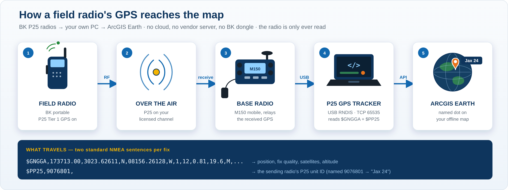
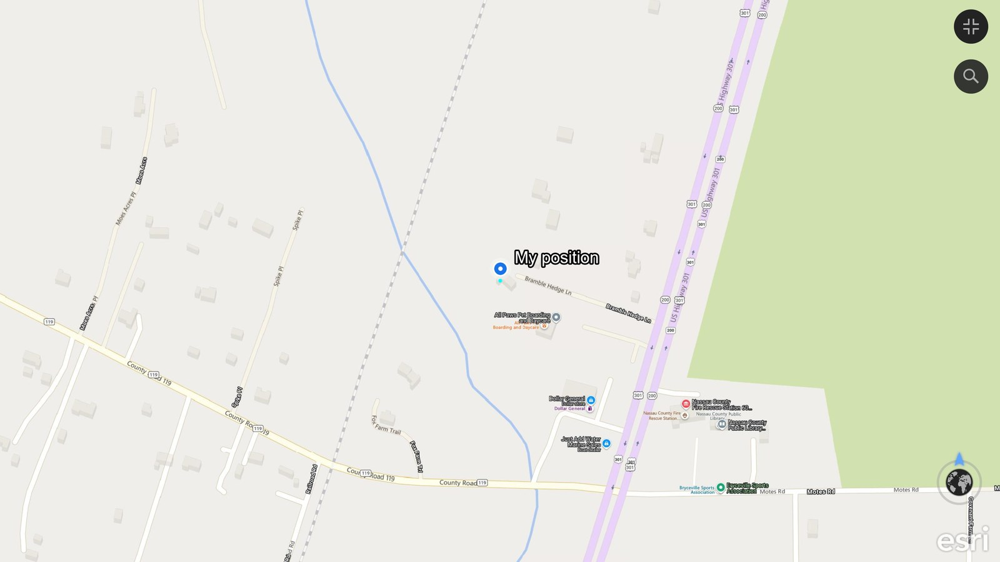
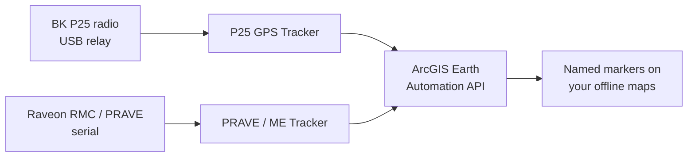

# ArcGIS Earth Map Plotting

> 🤖 **Using AI assistance?** Have the agent read the [CLAUDE.md](https://github.com/Jim-dc95811/ArcGIS-Earth-Unlocked/blob/main/CLAUDE.md) file first.

**Plot live positions on your own offline ArcGIS Earth maps** — radio GPS, tracked units, your own position — and keep the picture useful when the network is gone. This is the **plotting** home of the family; the maps you plot on are built with the companion [TPKX map-production tools](https://github.com/Jim-dc95811/QGIS-Mbtile-to-ArcGIS-Earth-TPKX) (QGIS → TPKX converter, Master 4 grid, ArcGIS Pro Batch Factory).

## 🛰️ NEW — P25 GPS Tracker: your radios' GPS, live on your offline map

**The original Holy Grail, achieved.** Pull GPS straight out of your agency's BK P25 radios and plot each unit — by name — on your own offline ArcGIS Earth imagery. Free and open: no cloud, no vendor subscription, no BK dongle. The tracker only ever **reads** the radio; it never reprograms anything.

*How a P25 radio's GPS reaches the map. ▶️ [Watch it work — BK Radio P25 GPS Map Plotter](https://www.youtube.com/watch?v=AapMfnJY7z0) (YouTube).*

### **⬇️ [DOWNLOAD P25 GPS TRACKER v0.13](downloads/P25_GPS_Tracker_v0.13.zip)**
**▶️ [Watch the demo — BK Radio P25 GPS Map Plotter (YouTube)](https://www.youtube.com/watch?v=AapMfnJY7z0)** · **[60-sec Short](https://www.youtube.com/shorts/X2DJc22vsnw)**
**📖 [Operator guide](docs/P25_GPS_TRACKER.md)**
**🔒 [Security summary for IT (PDF)](docs/P25_GPS_Tracker_Security_Summary.pdf)**
**⭐ EASIEST WAY — [Get all 11 tools from Google Drive](https://drive.google.com/drive/folders/1jsxVTDsYdgJHibhCCeI9I69FsG0qMGgc?usp=sharing)** — no download warnings, the whole series is under 10 MB. Open the folder, open the tool you want, and run its one `.bat`.

**📦 [Download the Whole ArcGIS Earth Unlocked Series of Tools](https://github.com/Jim-dc95811/ArcGIS-Earth-Unlocked/raw/main/downloads/ArcGIS_Earth_Unlocked_All_Tools.zip)**

- **One marker per unit, by name.** The sending radio's P25 unit ID is the key; name it once (`9076801 → Jax 24`) and it sticks across sessions. An un-named unit still shows its raw ID, so no dot is ever a mystery.
- **Live-tested on real radios.** Two portables reporting through a base M150 relay plotted as two separate, named, correctly-separated units on offline imagery — pinpoint accurate.
- **Built for the field.** Live / Stale / Expired aging (amber marker + age label), a pick-your-own retirement time (30 minutes to Never), keepalive + auto-reconnect, coordinate sanity, and a daily CSV track log.
- **How it works:** the base radio, connected as a USB Ethernet/RNDIS gadget, relays each received fix as standard NMEA — a `$GNGGA` position plus a proprietary `$PP25` unit-ID sentence — which the tracker reads and draws through ArcGIS Earth's local Automation API. Nothing is decrypted; it is standard interoperability with your own equipment on your own licensed channels.
- **Your own position too (v0.13).** Plug a Garmin USB GPS into the same PC and the tracker plots **where you are** as a blue **My position** marker, right alongside the radio units — a third "GPS connected" light, a **GPS DISCONNECTED** alarm, and a **Keep me centered** toggle you can switch on and off live. Every source — radio, Garmin, ArcGIS Earth — connects on its own; any one, any two, or none can be absent and the program keeps running.

> The standalone tracker above is the proven, everyday tool most operators will use. If you also run a Raveon fleet, the same P25 feed folds into the **PRAVE / ME Tracker** as a third source — see the *trifecta* build under that tool below.

---

## 🧭 NEW — Garmin USB GPS Tracker: your own position, live on your offline map

Plug in a **Garmin USB GPS** (GPS 18 USB and kin) and plot **your own live position** on your offline ArcGIS Earth map — **no COM port, no NMEA**. A Garmin USB puck speaks Garmin's proprietary *binary* USB protocol through Garmin's own driver; this tool talks that protocol directly, in pure Python, and draws your position as a single marker that follows you. Read-only to the GPS; it never reprograms it.

### **⬇️ [DOWNLOAD GARMIN USB GPS TRACKER v0.1](downloads/Garmin_USB_GPS_Tracker_v0.1.zip)**
**📖 [Operator guide](docs/GARMIN_USB_GPS_TRACKER.md)** · the PDF user manual is inside the zip, next to the `.bat`.
**⭐ EASIEST WAY — [Get all 11 tools from Google Drive](https://drive.google.com/drive/folders/1jsxVTDsYdgJHibhCCeI9I69FsG0qMGgc?usp=sharing)** — no download warnings, the whole series is under 10 MB. Open the folder, open the tool you want, and run its one `.bat`.

**📦 [Download the Whole ArcGIS Earth Unlocked Series of Tools - all 11 in one zip](https://github.com/Jim-dc95811/ArcGIS-Earth-Unlocked/raw/main/downloads/ArcGIS_Earth_Unlocked_All_Tools.zip)**

- **No COM port, no NMEA.** It reads the Garmin's binary USB protocol straight through Garmin's existing driver (pure Python, ctypes) — nothing installed or changed on the device, and no other Garmin software is affected.
- **Your position, once a second.** A blue **“My position”** marker drops where you are and follows you; an optional *Keep me centered* re-centres the map on each fix.
- **Field-ready.** Two start-ready lights (GPS connected / ArcGIS Earth API ready), a live Fix / lat-lon / accuracy / speed readout, auto-reconnect if the GPS is unplugged, and a daily CSV track log.
- **Live-proven** on a Garmin GPS 18 USB: 3D fix plotted dead-on the operator's real location on offline imagery.

*Your real position, read from the Garmin's binary USB stream and drawn on offline imagery.*

---

## Get everything you need

**1. ⬇️ [ArcGIS Earth](https://www.esri.com/en-us/arcgis/products/arcgis-earth/downloads)** - free 3D globe from Esri (Windows desktop version); it shows your offline maps and plots the units on them.

**2. ⬇️ [Python 3](https://www.python.org/downloads/windows/)** - free; install with the default options. The PRAVE / ME tracker and the tester need one add-on, `pyserial`, which their launchers **install automatically** the first time (needs internet once). The P25 GPS Tracker needs no add-ons at all.

> **First time? Three quick tips**
> 1. **Extract the zip first:** right-click the downloaded zip > **Extract All**, then open the new folder. Double-clicking files while they are still inside the zip does not work.
> 2. **Windows security warning:** Windows may warn about any program downloaded from the internet. Click **More info > Run anyway** (blue "Windows protected your PC" screen) or **Run**. To avoid the warning, right-click the zip > **Properties** > tick **Unblock** > **OK** before extracting.
> 3. **Installing Python:** if the installer shows **"Add python.exe to PATH"**, tick it.

### **⬇️ [DOWNLOAD PRAVE / ME TRACKER v2.1](downloads/PRAVE_ME_Tracker_v1.zip)**
**📖 [User manual](docs/PRAVE_ME_TRACKER.md)**
**🗂️ [What's in the zip - every file explained](images/prave_me_tracker_whats_in_the_zip_full.png)**
**⭐ EASIEST WAY — [Get all 11 tools from Google Drive](https://drive.google.com/drive/folders/1jsxVTDsYdgJHibhCCeI9I69FsG0qMGgc?usp=sharing)** — no download warnings, the whole series is under 10 MB. Open the folder, open the tool you want, and run its one `.bat`.

**📦 [Download the Whole ArcGIS Earth Unlocked Series of Tools - all 11 in one zip](https://github.com/Jim-dc95811/ArcGIS-Earth-Unlocked/raw/main/downloads/ArcGIS_Earth_Unlocked_All_Tools.zip)**

Track ME and remote PRAVE units directly in ArcGIS Earth through the local Automation API. **2.1:** if ArcGIS Earth is closed or restarted, every unit comes straight back on the map when it returns; a wrong or busy COM port is explained in plain words (with the ports this PC has); logs start a new file each day; a unit quiet for 5 minutes shows its age in its label (`7-101 · 12 min`) ([2.1 changes](docs/PRAVE_ME_TRACKER_V2.1_CHANGES.md)). v1.1 fixed the launchers and keeps units on the map through a serial reconnect; v1.2 keeps a Windows proxy setting from blocking the connection to ArcGIS Earth; v1.2.1's launcher installs pyserial by itself; v1.2.2 is a tidier folder - `START_TRACKER.bat` plus `System Files` ([changes](docs/PRAVE_ME_TRACKER_V1.1_CHANGES.md)). **v1.2.3 (Ready to Fly):** `START_TRACKER.bat` finds Python or installs it for you (no admin - answer **Y**), installs pyserial if missing, starts ArcGIS Earth if it is not open and checks its Automation API; the tracker is unchanged.

> **Trifecta — ME + Raveon fleet + P25 on one map.** The P25 feed folds into this tracker as a third source, so ME, the Raveon `$PRAVE` fleet, and the P25 radios share one map and one ArcGIS Earth API owner. **⬇️ [Download PRAVE / ME / P25 Tracker v3.0](downloads/PRAVE_ME_Tracker_v3.0.zip)** — new bench build (passes its self-test and real-capture tests; full field test with live radios still pending).

*ME (blue marker) and remote unit 1-173 drawn live in ArcGIS Earth. ▶️ [Watch the video](https://www.youtube.com/watch?v=JKWJmEIBP_I) (YouTube).*

### **⬇️ [DOWNLOAD PRAVE / RMC FIELD DECODER TESTER v1.0 GOLD](downloads/PRAVE_RMC_Field_Decoder_Tester_v1_0_Gold.zip)**
**📖 [User manual (PDF)](docs/PRAVE_RMC_Field_Decoder_Tester_v1_0_Gold_Instructions.pdf)**
**🗂️ [What's in the zip - every file explained](images/prave_rmc_tester_whats_in_the_zip_full.png)**

Bench-test the PRAVE / ME tracker without a radio: a simulated Raveon RMC/PRAVE stream with six units covering every RSSI icon ([bench-test guide](docs/PRAVE_ME_TRACKER.md#bench-testing-without-a-radio)).

## Make the maps first

These tools **plot on** offline maps; they don't make them. Build the maps once with the companion production repo, then plot live on them here:

**🗺️ [ArcGIS Earth TPKX map production](https://github.com/Jim-dc95811/QGIS-Mbtile-to-ArcGIS-Earth-TPKX)** — the QGIS → TPKX converter, the [Master 4 Grid Maker](https://github.com/Jim-dc95811/QGIS-Mbtile-to-ArcGIS-Earth-TPKX/blob/main/MASTER4_GRID_MAKER.md) for planning large areas, and the ArcGIS Pro **TPKX Batch Factory**.

Load your TPKX maps into ArcGIS Earth, start a tracker here, and the units draw straight onto your own imagery — no network needed.

## The tools

| Tool | Job |
|---|---|
| **P25 GPS Tracker** | Reads GPS from BK P25 radios over the base radio's USB link and plots each unit, by name, directly in ArcGIS Earth. |
| **PRAVE / ME Tracker** | Reads mixed RMC/PRAVE serial data and draws/tracks ME and remote units directly in ArcGIS Earth through the local Automation API. A P25-integrated build — the [trifecta v3.0](downloads/PRAVE_ME_Tracker_v3.0.zip) (ME + Raveon fleet + P25 on one map) — is available as a new bench build. |
| **PRAVE / RMC Field Decoder Tester** | Simulated radio stream for trying the PRAVE / ME tracker on the bench. |

## Watch the project

| | |
|---|---|
|  **BK Radio P25 GPS Map Plotter** — radio GPS live on the offline map |  **Key a radio, watch it hit the map — live** (Short) |
|  **ArcGIS Earth Offline Georeferenced Chart Plotting** |  **Pre-Loaded Satellite Maps for First Responders** |
|  **Transforming an Android Phone into an ArcGIS Earth Map Viewer** | |

These short videos show ArcGIS Earth as an offline georeferenced chartplotter, why pre-loaded imagery matters when the network is gone, and how Android can become a dedicated offline ArcGIS Earth viewer.

## How it plots

Every tool here is a reader-and-drawer: it reads positions off a radio and draws them into ArcGIS Earth through the documented local **Automation API** — markers for units, camera recenter for ME. Nothing is written back to the radios (beyond the one P25 subscribe request), and nothing goes to the internet.

## Manuals

- [P25 GPS Tracker - Operator Guide](docs/P25_GPS_TRACKER.md)
- [P25 GPS Tracker - Security Summary for IT (PDF)](docs/P25_GPS_Tracker_Security_Summary.pdf)
- [PRAVE / ME Tracker - Guide](docs/PRAVE_ME_TRACKER.md)
- [PRAVE / RMC Field Decoder Tester - Instructions (PDF)](docs/PRAVE_RMC_Field_Decoder_Tester_v1_0_Gold_Instructions.pdf)
- [End-to-end workflow](docs/WORKFLOW.md) · [Mobile offline field notes](docs/MOBILE_OFFLINE.md)
- Making the maps: the [TPKX production tools](https://github.com/Jim-dc95811/QGIS-Mbtile-to-ArcGIS-Earth-TPKX) (companion repo).

## What is field-proven here

- ArcGIS Earth desktop **ME center-screen tracking** through the local Automation API while preserving the operator's selected zoom.
- **PRAVE unit plotting** with unit labels and RSSI-driven icon states.
- **P25 GPS** from BK radios plotted as named units in ArcGIS Earth — live-tested with two portables reporting through a base M150 relay, correctly separated and pinpoint accurate.
- Plotting on a district-wide **300+ GB Z20 offline imagery archive**, exercised on Windows desktops/laptops, Android phones/tablets, and an Amazon Fire tablet (TPKX opened from internal storage, microSD, and exFAT USB).

Project-tested behavior is described as such; it should not be read as a guarantee for every Android OEM, ArcGIS version, storage device, or radio configuration.

## Requirements at a glance

### P25 GPS Tracker
- Windows
- ArcGIS Earth desktop with the Automation API enabled
- Python 3 (standard installer; Tk included; no extra libraries)
- A BK base radio connected as the USB Ethernet/RNDIS gadget, with Base Station Relay feeding it received GPS

### PRAVE / ME Tracker
- Windows
- ArcGIS Earth desktop with the Automation API enabled
- Python 3 + `pyserial` (installed automatically by `START_TRACKER.bat` the first time)
- RMC/PRAVE serial source (or the Field Decoder Tester for the bench)

## Offline does not mean unlicensed

This repository contains plotting tools and documentation, **not a redistributed imagery archive**. Users are responsible for the licensing, export permissions, and terms that apply to the map services/data they use to create the TPKX maps these tools plot on.

## Licensing

- **Source code and software packages:** [MIT License](LICENSE)
- **Original documentation, diagrams, manuals, written project material, and original project screenshots:** [Creative Commons Attribution 4.0 International (CC BY 4.0)](LICENSE-DOCS)

Third-party software, imagery, basemaps, trademarks, logos, user-interface elements, and other third-party content retain their own licenses and rights. These project licenses do not relicense ArcGIS, ArcGIS Pro, ArcGIS Earth, Esri imagery or basemaps, or other third-party material.

## Human-AI engineering collaboration

This toolchain was conceived, directed and field-tested by **Jim Gaddy**, working with **OpenAI's ChatGPT** and **Anthropic's Claude** as AI coding and documentation partners. Jim supplied the field problem, the radio and GPS hardware, and the live tests; the PRAVE / RMC Field Decoder Tester is Jim's own Gold bench tool. ChatGPT helped build the original PRAVE / ME Tracker. Claude built the tracker's 1.1, 1.2 and 1.2.1 releases (tested end to end against Jim's Gold tester and a mock ArcGIS Earth), the self-installing launchers, the user guides and PDFs, and the 'What's in the zip' sheets. Claude also built the **P25 GPS Tracker** — reverse-engineered with Jim from his own radio captures (the relay turned out to be standard NMEA over the base radio's USB network link) and live-tested on his BK fleet.

This acknowledgment is not a claim of OpenAI or Anthropic sponsorship or endorsement.

## Official ArcGIS references

See [Official Esri References](docs/OFFICIAL_ESRI_LINKS.md) for the ArcGIS Earth Automation API, local-file support, and ArcGIS Pro offline tile-cache documentation.

## Project status

The tool ZIPs are cleaned project distributions built from the current field-tested packages. The PRAVE / RMC Field Decoder Tester ZIP is the owner's Gold bench generator, published unmodified. The **ArcGIS TPKX Batch Factory** moved to the [TPKX map-production repo](https://github.com/Jim-dc95811/QGIS-Mbtile-to-ArcGIS-Earth-TPKX) on 2026-11-11 so all map-*making* tools live together; this repo keeps all map-*plotting* tools. The earlier TPKX Extent Tool v2 was retired on 2026-11-01 in favor of the Master 4 system; both remain in Git history.

---

**Independent project.** ArcGIS, ArcGIS Pro, and ArcGIS Earth are Esri products and trademarks. This repository is not an Esri product or official Esri distribution.
