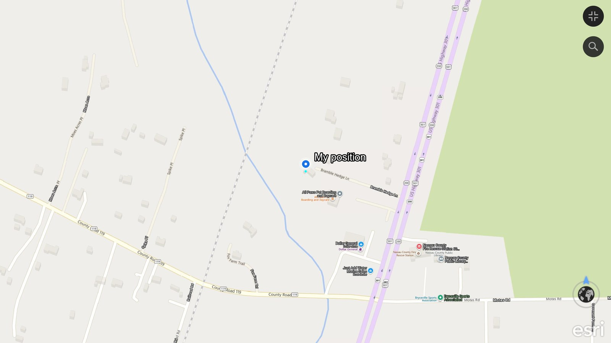

# Garmin USB GPS Tracker — Operator Guide

Your own live position, straight from a **Garmin USB GPS** (GPS 18 USB and kin), plotted on your own offline ArcGIS Earth map. Free and open — no cloud, no COM port, no NMEA. The tracker only ever **reads** the GPS.

*Your real position, read from the Garmin's binary USB stream and drawn on offline imagery.*

---

## Installing — read this first

1. **Open the tool's folder.** Easiest is **Google Drive** (the link at the top of the project page): the `Garmin_USB_GPS_Tracker_v0.1` folder is already unpacked — just open it, nothing to extract. If you downloaded the **zip** from GitHub instead, right-click it → **Extract All** first, then open the new folder. Double-clicking files while they are still inside a zip does not work.
2. **Python 3** is required (the standard [python.org](https://www.python.org/downloads/windows/) installer, which includes Tk for the window). Tick **“Add python.exe to PATH”**. No other libraries.
3. **Dependency — a Garmin USB GPS** plugged in, with Garmin's USB driver installed (it appears in Device Manager under **GARMIN Devices**). Close any other Garmin program (Garmin Express, BaseCamp, an old GPS app) — only one program can hold the GPS at a time.
4. **Dependency — ArcGIS Earth with the Automation API on:** ArcGIS Earth → Settings → Advanced application settings → enable **Automation API** (uses `http://localhost:8000`).
5. Double-click **`Garmin USB GPS Tracker.bat`**.

---

## How it works

A Garmin USB GPS does **not** present a serial/NMEA COM port. It speaks Garmin's proprietary **binary USB protocol** through Garmin's own kernel driver. This tool talks that protocol directly, in pure Python (ctypes) — no driver change, no libusb, nothing that disturbs your other Garmin software:

1. It finds the GPS by Garmin's USB interface class and opens it through the driver.
2. It starts a session (the unit replies with its serial/unit ID).
3. It asks for live position (`Start_Pvt_Data`); the GPS then streams a **PVT record about once a second** — a packed binary structure with latitude/longitude (in radians), fix quality, altitude and speed.
4. The tool reassembles each record off the interrupt pipe, converts radians to degrees, and draws a single marker through ArcGIS Earth's local Automation API.

It is read-only to the GPS apart from the standard start/stop-PVT commands — nothing is reprogrammed.

## Using it

1. With ArcGIS Earth open (API on) and the Garmin plugged in, open the app. The two lights at the top — **GPS connected** and **ArcGIS Earth API ready** — go green on their own when both are ready, before you press anything.
2. Click **Start tracking**. Once the GPS has a fix, a blue **“My position”** dot drops on the map and follows you.
3. **Keep me centered** (top-right): off by default, so the map stays where you put it (the dot still updates); tick it and the map re-centres on you with each fix.
4. **Stop** ends tracking and removes the marker.

## The Position box

| Field | Meaning |
|---|---|
| **Fix** | `3D` / `2D` (green) once locked on; `no fix` (amber) while searching. A clear view of the sky gives the best fix. |
| **Latitude, Longitude** | Your current position in decimal degrees. |
| **Accuracy** | The GPS's own position-error estimate, in metres. |
| **Speed** | Ground speed in mph. |

Every fix is written to a dated CSV in the `Logs` folder (`garmin_track_YYYYMMDD.csv`): time, lat, lon, fix, altitude, accuracy, speed — ready for after-action or import.

## Good to know

- It uses Garmin's **existing** driver — nothing is installed or changed on the device, and no other Garmin software is affected.
- Indoors or under cover the GPS may sit at a rough fix with a large accuracy number — that is the receiver, not the tool. Outdoors it tightens up.
- Works with Garmin USB pucks that stream PVT (the common GPS 18 USB among them).
