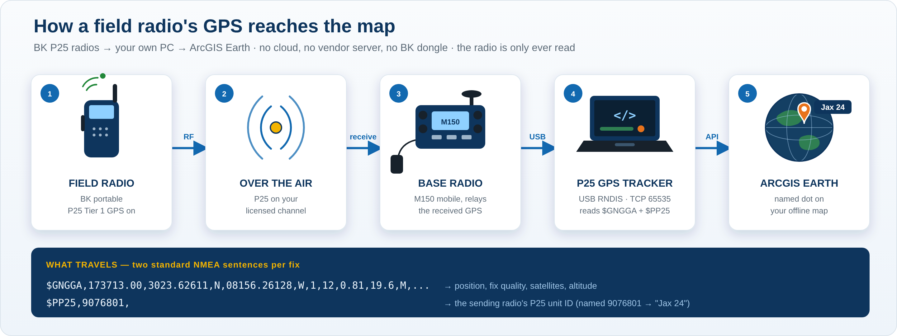
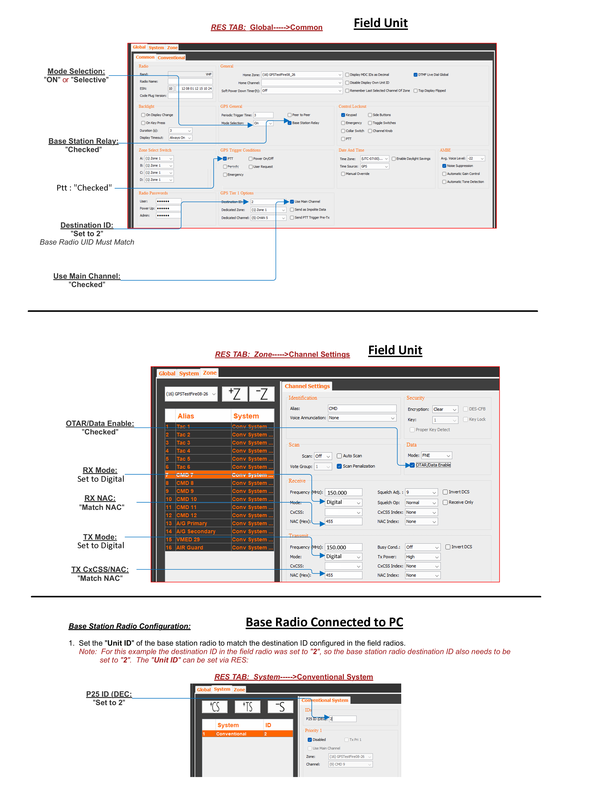

# P25 GPS Tracker — Operator Guide

Live GPS from BK P25 radios, plotted as named units on your own offline ArcGIS Earth maps. Free and open — no cloud, no vendor server, no BK dongle. The tracker only ever **reads** the radio.

> 🔒 **For IT / security review:** [P25 GPS Tracker — Security Summary (PDF)](P25_GPS_Tracker_Security_Summary.pdf) — a plain-language, cyber-audit-style write-up: exactly what it does, every network call, dependencies (standard library only), file hashes, and how to run it in a managed environment.



---

## Installing — read this first

1. **Extract the zip** (right-click → **Extract All**), then open the new `P25_GPS_Tracker_v0.12` folder. Double-clicking files inside the zip does not work.
2. **Python 3** is required (the standard [python.org](https://www.python.org/downloads/windows/) installer, which includes Tk for the window). Tick **“Add python.exe to PATH”** during setup. No other libraries are needed.
3. **Dependency — ArcGIS Earth with the Automation API on:** ArcGIS Earth → Settings → Advanced application settings → enable **Automation API** (the tracker uses `http://localhost:8000`).
4. **Dependency — the base radio connected** as the USB **Ethernet/RNDIS Gadget** (it appears at `10.250.46.6`), with Base Station Relay feeding it received GPS.
5. Double-click **`P25 GPS Tracker.bat`** to open the control panel.

---

## How it works

Over its USB link the BK base radio is a small networked device. It relays each received field-radio GPS fix as **two standard NMEA sentences** on a TCP service:

```
$GNGGA,173713.00,3023.62611,N,08156.26128,W,1,12,0.81,19.6,M,...   ← position, fix quality, satellites, altitude
$PP25,9076801,                                                     ← the sending radio's P25 unit ID
```

The tracker subscribes with one short request, reads the pair per fix, and draws **one marker per unit** on your ArcGIS Earth map through the local Automation API. The P25 unit ID is the per-unit key, so each radio keeps its own dot and its own name.

Nothing is decrypted, no password is used, and the radio is never reprogrammed — this is standard interoperability with your own equipment on your own licensed channels.

## Programming the BK radios (RES)

The field radios and the base-station relay radio are set up in BK's RES programming software. The diagram below shows the settings that make the GPS relay work: the **field unit** (GPS triggered on PTT, Base Station Relay checked, a Destination ID) and the **base radio** (its Unit ID set to match that Destination ID). In this example the Destination ID is **2**, so the base radio's P25 ID is also set to **2** — the two must match.



*Field-unit and base-radio RES settings. The field unit's **Destination ID** and the base radio's **Unit ID** must be the same value.*

## Using it

1. With ArcGIS Earth open (API on) and the base radio connected, open the app. The two lights at the top — **Radio connected** and **ArcGIS Earth API ready** — go green on their own as soon as both are ready, *before* you press anything, so you can see you're start-ready at a glance. Click **Start tracking**.
2. **Set the retirement time** (top-right, *“Drop idle units after”*) if 2 hours isn't right for the day — a short incident might want 30 minutes; a long operation might want 8 hours or **Never remove**.
3. **Send a GPS from a field radio.** That unit appears in the Units table (status **Live**, green) and a firetruck marker drops on the map **at its true location — your view does not move**, so calls from every distance stay where they belong.
4. **Name a unit:** double-click its row, type the alias (e.g. `9076801 → Jax 24`), Save. The map label updates immediately and the name is remembered.
5. **Stop** ends tracking; markers stay. Closing the window saves your aliases and settings.

## Status and aging

| Status | Meaning |
|---|---|
| **Live** (green) | Reporting normally; the firetruck marker is red. |
| **Stale** (amber) | No new fix for a few minutes; the firetruck turns amber and its label shows the age (`Jax 24 · 12 min`). |
| **Expired** (grey) | Silent past the retirement time; the marker is removed. Set **Never remove** and this won't happen. |

## Aliases and settings

- **Aliases** are saved in `System Files\aliases.json`, keyed by the P25 unit ID, and reloaded every session — name a radio once and it sticks across reconnects and reboots. An un-named unit simply shows its raw ID, so no unit is ever a mystery dot.
- **Retirement time** is saved in `System Files\settings.json`.
- **Finer tuning** in `System Files\p25_core.py` (CONFIG): `RADIO_IP/PORT`, `STALE_AFTER_MINUTES` (when amber starts), `KEEPALIVE_SECONDS`, `WATCHDOG_SECONDS`.
- Every fix is written to a dated CSV in the `Logs` folder (`p25_track_YYYYMMDD.csv`): time, unit, lat, lon, altitude, satellites — ready for after-action or import.

## Hardening built in

- **Keepalive & watchdog** keep the link alive on long runs and reconnect on their own if it goes quiet.
- **Coordinate sanity** rejects empty or impossible fixes, so a garbled packet can never place a false dot.
- **Visible aging** turns a quiet unit amber with its age, so an old position never looks current.
- **Adjustable retirement** (v0.4) — you choose how long an idle unit stays on the map.

### New in v0.5

- **Your view stays put.** A new position no longer zooms or re-centers the map on that unit. Units come in from every distance — one off the edge of the screen is still plotted and appears when you zoom out, but the view never jumps to it.
- **Firetruck markers** replace the plain dot — red while live, amber when stale.
- **Zoom-aware icons** shrink as you zoom out and disappear above **200,000 ft** (`HIDE_ABOVE_FT` in `p25_core.py`), so a wide view isn't buried in markers; units keep tracking while hidden and return when you zoom back in.
- **Two status lights** — **Radio connected** and **ArcGIS Earth API ready** — show green/red at the top of the panel so link health is one glance away.

### New in v0.6

- **The status lights are larger and run before Start.** They light up the moment the app opens (a read-only check that the radio port answers and the ArcGIS Earth API is on — no subscribe, no traffic) and refresh every couple of seconds, so a glance tells you whether you're start-ready without pressing anything.

### New in v0.7

- **On-screen badge over ArcGIS Earth.** A small **P25 TRACKER · running** badge pins to the bottom-right of the screen, above the Esri logo of a full-screen ArcGIS Earth, and stays there the whole time the tracker runs — so if it ever disappears, you know the program stopped (even if you were looking at the map, not the panel). It's click-through, so it never blocks the map.
- **RADIO DISCONNECTED alarm.** While tracking, if the radio link drops, a red **RADIO DISCONNECTED** banner blinks just above the badge until the radio comes back.
- The badge anchors to the screen corner (it assumes ArcGIS Earth is maximised, which is how these tools are used), and like EarthStick's readout it fails safe — if the overlay can't draw on your setup, the tracker runs exactly as before. (v0.9 pins to the screen's bottom-right corner — no window or process lookup at all; v0.8's title match failed because ArcGIS Earth names its window after the open workspace, e.g. *Legacy Workspace*.)

## Field-proven

Live-tested on real BK radios: two portables reporting through a base M150 relay appeared as two separate, correctly-separated, named units on offline imagery, with live aging and adjustable retirement — pinpoint accurate.

## One map with ME and the Raveon fleet (trifecta — in testing)

The same P25 feed also folds into the [PRAVE / ME Tracker](PRAVE_ME_TRACKER.md) as a third source, so ME (own position), the Raveon `$PRAVE` fleet, and the P25 radios share one map and one ArcGIS Earth API owner. That integrated build is in bench testing; the standalone P25 GPS Tracker above is the proven, everyday tool and the one most operators will use.
