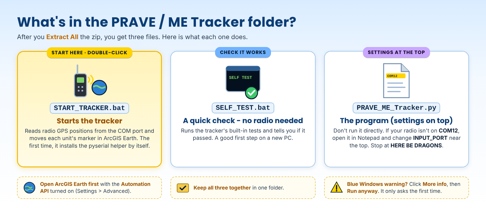

# PRAVE / ME Tracker 2.1 Guide

<!-- install-blurb:start -->
> ### Installing the PRAVE / ME Tracker - read this first
>
> 1. **Open the tool's folder.** Easiest is **Google Drive** (the link at the top of the project page): the folder is already unpacked - just open it, nothing to extract. If instead you downloaded the **zip** from GitHub, right-click it > **Extract All** first, then open the new folder. (Double-clicking files while they are still inside a zip does not work.)
> 2. **Double-click `START_TRACKER.bat`** - the only .bat in the folder. This manual sits right next to it. The **System Files** folder holds the program - leave it alone.
> 3. **Blue "Windows protected your PC" box?** Click **More info**, then **Run anyway**. It only asks the first time. (Or, before extracting: right-click the zip > **Properties** > tick **Unblock** > **OK**.)
> 4. **Python - nothing to install by hand.** If Python is missing, the window asks **Install Python now? [Y/N]**: type **Y** and press Enter. It installs just for you (no admin needed) - and the pyserial library too. On an older PC this can take several minutes and Windows Defender may make the PC look frozen - **do not close the window**.
> 5. Install **ArcGIS Earth** (free from Esri: https://www.esri.com/en-us/arcgis/products/arcgis-earth/downloads). The .bat starts it for you and checks its Automation API is on (Settings > Advanced application settings > tick **Enable Automation API**).
> 6. The serial port settings (`INPUT_PORT`, default COM12, and `INPUT_BAUD`) are at the top of `System Files\PRAVE_ME_Tracker.py`.
>
> Something stops it? The window says what to do in plain words, and keeps a log in `System Files\Ready_To_Fly_log.txt`. On a work computer that blocks installs, ask IT to install Python 3 from python.org.
<!-- install-blurb:end -->

A printable copy of this guide is available as [PRAVE_ME_Tracker_User_Guide.pdf](PRAVE_ME_Tracker_User_Guide.pdf).


**Current version: v1.2.3** (2026-11-08: Ready to Fly launcher - installs Python and pyserial if missing, starts ArcGIS Earth and checks its API. 2026-11-06: one obvious file - the zip holds `START_TRACKER.bat` and `System Files`; program unchanged from v1.2 of 2026-10-31. v1.2.1, 2026-11-02: launcher installs pyserial automatically). See [PRAVE_ME_TRACKER_V1.1_CHANGES.md](PRAVE_ME_TRACKER_V1.1_CHANGES.md) for what changed in v1.1 and v1.2.

The PRAVE / ME Tracker replaces the older KML/NetworkLink display path with direct ArcGIS Earth Automation API control.

## Data path

```text
$GPRMC / $GNRMC -> checksum -> ME position -> ArcGIS Earth drawing -> camera center
$PRAVE          -> checksum -> remote position/ID/RSSI -> ArcGIS Earth drawing
```

The decoder preserves the proven PRAVE field layout used by the earlier Gold field decoder: latitude at field 3, longitude at field 4, district at field 8, RSSI at field 12, and individual ID at field 13. Display IDs use `district-individual`, with the individual padded to three digits.

## Why the camera tracking works

The tracker reads ArcGIS Earth's current camera, replaces only the camera X/Y with the current ME longitude/latitude, and writes the camera back. Camera height, heading, tilt, and roll are preserved. In live testing this kept ME centered without the aggressive zoom changes seen with KML Fly to View.

## Requirements

- Windows 10/11
- ArcGIS Earth desktop
- ArcGIS Earth Automation API enabled
- Python 3 and pyserial - since 1.2.3 `START_TRACKER.bat` installs both for you if they are missing (answer **Y**; no admin needed), and starts ArcGIS Earth if it is not open
- `pyserial` - `START_TRACKER.bat` installs it automatically the first time (v1.2.1; internet needed once). By hand: `py -3 -m pip install pyserial`
- Mixed Raveon RMC/PRAVE serial input

## ArcGIS Earth setup

1. Open **Settings**.
2. Open **Advanced application settings**.
3. Enable **Automation API**.
4. Leave the default local endpoint at `http://localhost:8000` unless you intentionally changed it.

## What's in the zip



## Tracker setup

1. Download [`PRAVE_ME_Tracker_v1.zip`](../downloads/PRAVE_ME_Tracker_v1.zip) and extract it. Open the extracted `PRAVE_ME_Tracker_v2.1` folder (the .bat, this guide as a PDF, and `System Files`), then `System Files`, and open `PRAVE_ME_Tracker.py` in Notepad (right-click > Edit).
2. Change only `INPUT_PORT` (default `COM12`) and, if necessary, `INPUT_BAUD` (default `19200`) above the `HERE BE DRAGONS` line. Save the file. If your RSSI icons live somewhere other than `C:\MyData\PRAVE_ME\Icons`, also set `ICON_FOLDER`. Not sure which port? Just start the tracker: if the port is wrong it lists the serial ports this PC has (2.1).
   `STALE_AFTER_MINUTES` (default `5`) sets when a quiet unit starts showing its age; `0` turns that off.
3. Optional check without a radio or ArcGIS Earth: in a Command Prompt in `System Files`, run `py PRAVE_ME_Tracker.py --self-test`.
4. Open ArcGIS Earth, connect the radio or test source, and run `START_TRACKER.bat`. The console shows status and unit counts; when the tracker stops, it prints its exit code and waits for a key press.

## RSSI icons

The six fire-truck PNGs are **not included** in the download. Place your own icons in `ICON_FOLDER` with these names: `firetruck_rssi_unknown.png`, `firetruck_rssi_1.png` through `firetruck_rssi_5.png`. At startup the tracker warns if the folder or any icon is missing. Units still appear with ArcGIS Earth's default marker until the icons are in place.

## ME tracking control

ME tracking starts enabled. Press **T** in the tracker console to toggle ME drawing replacement and camera recentering off/on.

## PRAVE drawing behavior

**Quiet units show their age (2.1).** A unit not heard from for 5 minutes (`STALE_AFTER_MINUTES`) gets its age in its map label, for example `7-101 · 12 min` or `7-101 · 2 h 05 min`, updated once a minute. Its next report puts the plain label (`7-101`) back.

The ArcGIS Earth Drawings API provides add/delete operations for the point drawing path used here, so fresh PRAVE reports replace the previous drawing. If an individual PRAVE unit is unchecked in ArcGIS Earth while the tracker is running, the next report can recreate it as visible. Stop the tracker to suspend all updates.

## Bench testing without a radio

The **PRAVE / RMC Field Decoder Tester v1.0 Gold** generates the same mixed serial stream the Raveon radio produces, so the tracker can be tested at a desk:

- one valid `$GPRMC` every second at a fixed ME position (30.419107, -81.926499);
- `$PRAVE` reports at random 1.5-3.5 second intervals from six units, 7-101 to 7-106, arranged in a small grid around ME;
- one unit per RSSI state, so every icon can be checked at once: 7-101 blank (unknown icon), then 7-102 to 7-106 at -115, -105, -95, -85 and -75 dBm (1 to 5 bars).

**Download:** [`PRAVE_RMC_Field_Decoder_Tester_v1_0_Gold.zip`](../downloads/PRAVE_RMC_Field_Decoder_Tester_v1_0_Gold.zip). It contains the tester program, its Windows launcher and the PDF instructions. It needs Python 3 and `pyserial`, like the tracker; since 2026-11-02 its launcher also installs `pyserial` automatically the first time. The tester program itself is Jim's unmodified v1.0 Gold.

### Connecting tester and tracker

The tester writes to one COM port and the tracker reads another. The two must be linked by a virtual COM-port pair, two FTDI adapters joined with a null-modem connection, or a null-modem cable.

**Both programs default to `COM12`, so change one of them.** For example, with a virtual pair COM11 <-> COM12:

```text
Tester  (top of PRAVE_RMC_Field_Decoder_Tester_v1_0_Gold.py):  OUTPUT_PORT = "COM11"
Tracker (top of PRAVE_ME_Tracker.py):                           INPUT_PORT  = "COM12"
```

Keep both at 19200 baud.

### Running a bench test

1. Run the tester self-test from a Command Prompt in the tester's `System Files` folder: `py PRAVE_RMC_Field_Decoder_Tester_v1_0_Gold.py --self-test` (or `python ...` if the `py` launcher is not installed). It should report 7 valid sentences.
2. Run the tracker's self-test the same way: `py PRAVE_ME_Tracker.py --self-test` in the tracker's `System Files`.
3. Open ArcGIS Earth with the Automation API enabled.
4. Start the tracker with `START_TRACKER.bat`, then start the tester with `Run_PRAVE_RMC_Field_Decoder_Tester_v1_0_Gold.bat`. (The tester's launcher calls `python`, so Python must be on the PATH: tick "Add python.exe to PATH" when installing Python.)
5. Within about 10-20 seconds, ME and all six trucks should appear, each with its own RSSI icon.
6. To test recovery, unplug the serial link for a few seconds and plug it back in. The trucks should stay on the map while the tracker reconnects.

### Where the tester PDF differs from this tracker

The tester's PDF instructions were written for the earlier Google Earth decoder (PRAVE / ME / Time Keeper). With the ArcGIS Earth tracker:

- The tester's default port is `COM12`, not `COM3` as the PDF says.
- The tracker's icon folder is `C:\MyData\PRAVE_ME\Icons`, not `...\PRAVE_ME_TimeKeeper\Icons`. Set `ICON_FOLDER` in the tracker if yours is elsewhere.
- The tracker draws units with labels only. The numeric RSSI is shown in the tracker console and logs, not in a placemark description.
- The tracker never changes the Windows clock, so the PDF's clock-synchronization notes do not apply.

The tester writes every sentence it sends to `logs/` beside the program, about 8 MB per day of continuous running. Delete old logs as needed.

## Reconnect behavior

If the serial link drops (USB cable pulled, radio power blip), the tracker keeps running and retries every 5 seconds. Units stay on the map at their last reported positions while it reconnects. Drawings left over from an earlier session are cleared only when the tracker starts.

**Each problem is said once (2.1).** A wrong or busy COM port, or ArcGIS Earth not answering, is written to the window and the log once; the tracker then keeps trying quietly and says when it connects.

- **COM port not found:** `COM12 was not found. Serial ports on this PC: COM3, COM7. Plug in the radio cable, or set INPUT_PORT ...`
- **COM port busy:** `COM12 is in use by another program (the PRAVE tester, another tracker or a terminal program) ...`
- **ArcGIS Earth closed or restarted while tracking (2.1):** `ARCGIS_EARTH_LOST` once - radio reports keep being logged - then `ARCGIS_EARTH_BACK - redrew N unit(s) and ME` once. Every known unit and ME go straight back on the map at their last positions, without waiting for new reports.

## Log messages

Logs are written to the `Logs` folder beside the program - since v1.2.2 that is inside `System Files`. **Since 2.1 there is one set of files per day**, for example `AE_PRAVE_Live_Activity_2026-11-08.log`, `AE_PRAVE_Packet_History_2026-11-08.csv` and `AE_RMC_Position_History_2026-11-08.csv` (the GPS file grows about 13 MB a day). Delete old days as needed. Useful entries:

- `API_BAD` - ArcGIS Earth did not accept an update; check that it is running with the Automation API enabled. (From v1.2 a Windows proxy setting can no longer cause this.)
- `RMC_BAD` / `PRAVE_BAD` - a sentence failed its checksum or field checks.
- `GPS_NO_FIX` / `GPS_FIX_RESTORED` - the GPS lost and regained its fix.
- `ICON_WARNING` - the icon folder or an icon file is missing.
- `RECONNECT` - the serial link dropped or the port is not there; the tracker tries every 5 seconds, quietly until something changes.
- `ARCGIS_EARTH_LOST` / `ARCGIS_EARTH_BACK` - ArcGIS Earth stopped answering / answers again (units and ME redrawn).
- `ERROR pyserial is not installed` or `pyserial could not be installed automatically` - run `py -3 -m pip install pyserial`, or ask IT if your network blocks downloads.
